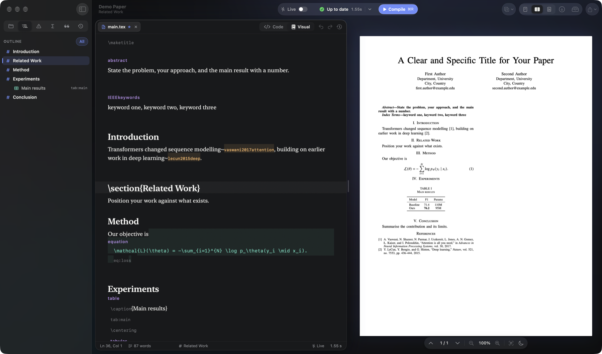

# Ligature

A native macOS LaTeX editor: write on the left, see the typeset PDF update on the right.



## Install

1. Download `Ligature-1.0.0.dmg` from [Releases](https://github.com/mithinsagar/Ligature/releases) and drag Ligature into Applications.
2. The app isn't notarised, so the first time macOS blocks it: open System Settings > Privacy & Security and click "Open Anyway".
3. Install a TeX engine once: `brew install tectonic` (it fetches only the packages your documents need). For Word export, also `brew install pandoc`.

## Features

- **Compile on demand or live.** Live compile is off by default: press Compile (⌘R) in the toolbar. Flip the Live switch to recompile as you type: compiles run back to back, so the PDF keeps updating while you type rather than waiting for a pause. While Live is off, the status shows "Edited" and the Compile button glows softly when the PDF is out of date. New PDFs crossfade in at the same scroll position.
- **Two-way SyncTeX.** Click any word in the PDF (single click, double-click, ⌘-click or force click) to jump to its source line, with that exact word marked strongly. ⌘⇧J shows the caret's line in the PDF with a highlight.
- **Editor.** LaTeX syntax colouring, a line gutter with issue markers, auto-closing braces and `$`, and `\begin{env}` + Return to close the environment. `\item` lines continue. Includes snippets with tab stops, ⌘/ to comment, and ⌘B / ⌘I / ⌘U.
- **Autocomplete** for commands, your own `\newcommand` macros, environments, `\ref` labels, `\cite` keys, `\input` files, images and packages.
- **Live equation preview** while the caret is inside math, rendered by the TeX engine with your own preamble and macros.
- **Hover and force-click peeks** for references (rendered equations), citations, images, included files and symbols.
- **Errors in plain English**, shown inline at the end of the line, with one-click fixes such as adding a missing package.
- **Outline** of sections, figures, tables and TODOs, following `\input` and `\include` across files.
- **Table builder** with a live rendered preview. Pasting spreadsheet data opens it pre-filled.
- **Figures:** drag or paste an image into the editor. It is copied into `figures/` and wrapped in a figure environment.
- **Citations:** add references by DOI, arXiv ID or a title search (Crossref).
- **Symbols palette** with search and recents.
- **Version history:** automatic snapshots after successful compiles, with a diff view and restore.
- **Undo and redo** buttons in the tab bar. Hover Undo (or click the clock) for the edit-history card: drag a scrubber through every edit since you opened the file, or jump back to the last compile or to when you opened it. All of these are undoable.
- **Code | Visual:** Visual mode shows the source as formatted prose (headings, emphasis, bullets, citation pills, captions) with LaTeX markup hidden, in a centred reading column. The line with the caret shows its raw LaTeX so you can edit it. It's the same text underneath, so switching is instant.
- **⌘K command palette:** commands, files, sections, labels, citations, and `:42` to go to a line.
- **Export:** Quick Download (⌥⌘D) saves the PDF straight into Downloads with no dialog. You can also download with a dialog, download as Word (.docx, via pandoc, with native Word equations and resolved citations), share, print, export a source .zip, or export for arXiv (comments stripped, `.bbl` included). Files are named after the main file (`report.tex` → `report.pdf`), or after the project when the main file is `main.tex`.
- **Saving:** files are written when you compile or press ⌘S, so what's on disk is what you last compiled. Unsaved tabs show a dot. Closing a tab or window, or quitting, with newer edits asks Save / Don't Save / Cancel.
- **Compile history:** every compile you start keeps its PDF. History → Compiles shows each one with a page thumbnail, word and page counts, and errors; open its PDF or go back to that version (your current state is saved first).
- **Previous downloads:** every PDF and zip you download is remembered with its own copy. The Downloads button lists them, so you can open, reveal or save any of them again, even if the original was moved or deleted.
- **Rename the project** from the window title menu, the Files panel or File → Rename Project. The folder, history and downloads move together.
- **Nine templates:** blank, article, IEEE-style paper, thesis, Beamer slides, résumé, letter, assignment and lecture notes.
- **Look and feel:** a softly lit backdrop under Liquid Glass chrome, a floating editor card, PDF pages that float with a soft glow, a light that travels around the compile pill while it works, five themes plus Automatic, seven accent colours, and a dark-paper PDF mode.
- **PDF zoom:** 100% means the page fits the pane's width with equal margins, and it keeps fitting as you resize. Pinch or use the buttons to zoom; the percentage follows. Click the percentage to return to 100%.
- **Compile ripple:** when a compile you started finishes, a circular ripple spreads from the centre of the page and reveals the new PDF as it goes, with a frosted glass edge, a soft bloom and trailing rings. It's drawn with Core Animation and stays on the page.
- **Haptics,** soft and only for three moments: the editor/PDF divider snapping to ⅓, ½ or ⅔, a force click, and the result of a compile you started. They can be turned off in Settings → Haptics.

## Requirements

- macOS 26 or later, Apple silicon or Intel.
- A TeX engine. Tectonic is recommended: `brew install tectonic`. It downloads only the packages a document needs. MacTeX's `latexmk` also works (Settings → Compile).

## Build

```sh
swift test                 # core parser tests
./scripts/build_app.sh     # → build/Ligature.app
```

`LigatureCore` (log, SyncTeX, outline, BibTeX, tables, symbols) has no UI and no third-party dependencies. The app uses SwiftUI with AppKit for the editor (TextKit 1) and PDFKit for the preview.

For scripted UI checks, set `LIGATURE_OPEN=/path/to/project` and `LIGATURE_SCRIPT="goto:12 ;; type:\frac ;; wait:1"` (see `Sources/Ligature/Support/TestScript.swift`).

Made by Mithin Sagar.
